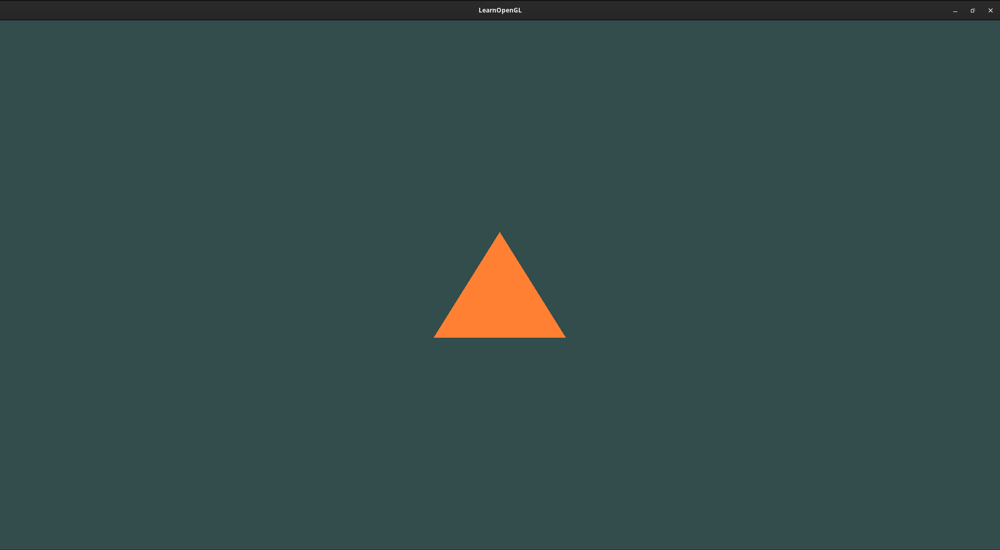

# LearnOpenGL
## _The moving triangle_
Dun dun dun!

I am trying to self learn OpenGL, using [LearnOpenGL](learnopengl.com). Why? Because it's interesting, fun, cool, and challenging. I have worked with [Raylib](raylib.com) in the past, so I have some low-level graphics programming knowledge, and a firm understanding of C++.

Currently I have a very interesting application, with a moving triangle:

Try it out [here](https://github.com/ofer-afik/LearnOpenGL/releases/tag/v0.2.0)!

### Linux
If, on linux, the system says something about "no app to run file of type executable", or something similar, know that this is a common problem. There are two solutions:
- The GUI, through the file browser, properties, then enable "executable as program"
- The terminal: run `chmod +x <path/to/filename>`
And that should solve it!
