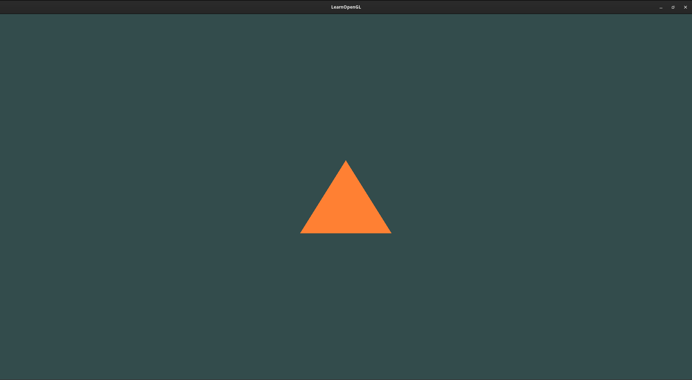

# LearnOpenGL
## Currently: an Example of a Phong Method Shader, using Assimp to load models
Dun dun dun!

I am trying to self learn OpenGL, using [LearnOpenGL](learnopengl.com). Why? Because it's interesting, fun, cool, and challenging. I have worked with [Raylib](raylib.com) in the past, so I have some low-level graphics programming knowledge, and a firm understanding of C++.

I have a scene with a BACKPACK! Amazing.

First release was a very interesting app, with a triangle:



Later it was a bit better:


And now, the current version is best.

Try it out [here](https://github.com/ofer-afik/LearnOpenGL/releases/tag/v0.4.0)!

## Controls
Arrows: move on the xy plane (remember - in most graphics programming topics, y is up)
Page up/down: move on z axis
Left click / escape: lock/unlock mouse for game controls - 
- Move for rotation
- Scroll for FOV


## Running on different platforms
***KEEP THE `src` FOLDER!***

### Building from source
For a local build, install GLFW, Assimp, and the platform's OpenGL development files, then run:
```sh
cmake -S . -B build
cmake --build build
```
The GitHub workflow builds GLFW and Assimp (including Assimp's bundled zlib) as static libraries and statically links the GNU C++ runtime where supported. OpenGL drivers and platform/window-system libraries are supplied by the operating system and cannot be statically bundled.

### Linux
Tested - there is no reason it shouldn't work!
You might need to make the executable runnable, though:
Right click file, enter properties, then enable it.

### Windows/Mac
It should work - tested through github runners, meaning I didn't find a way to test through actual GUI. It *should* work.