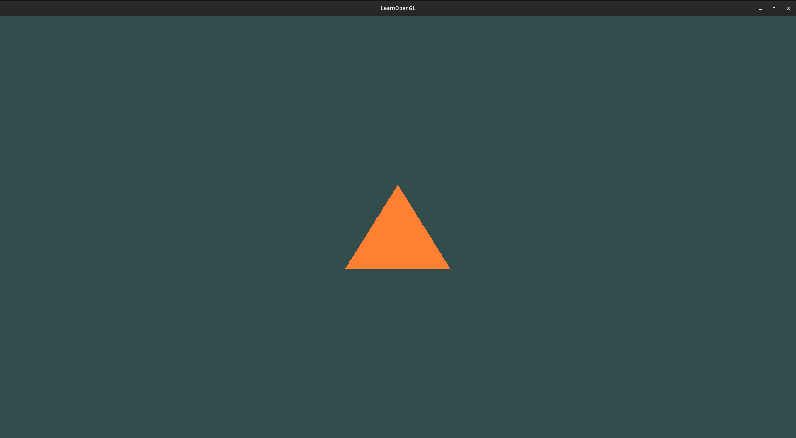

# LearnOpenGL
## _The moving triangle_
Dun dun dun!

I am trying to self learn OpenGL, using [LearnOpenGL](learnopengl.com). Why? Because it's interesting, fun, cool, and challenging. I have worked with [Raylib](raylib.com) in the past, so I have some low-level graphics programming knowledge, and a firm understanding of C++.

Currently I have a very interesting application, with a moving triangle:

Try it out [here]()!